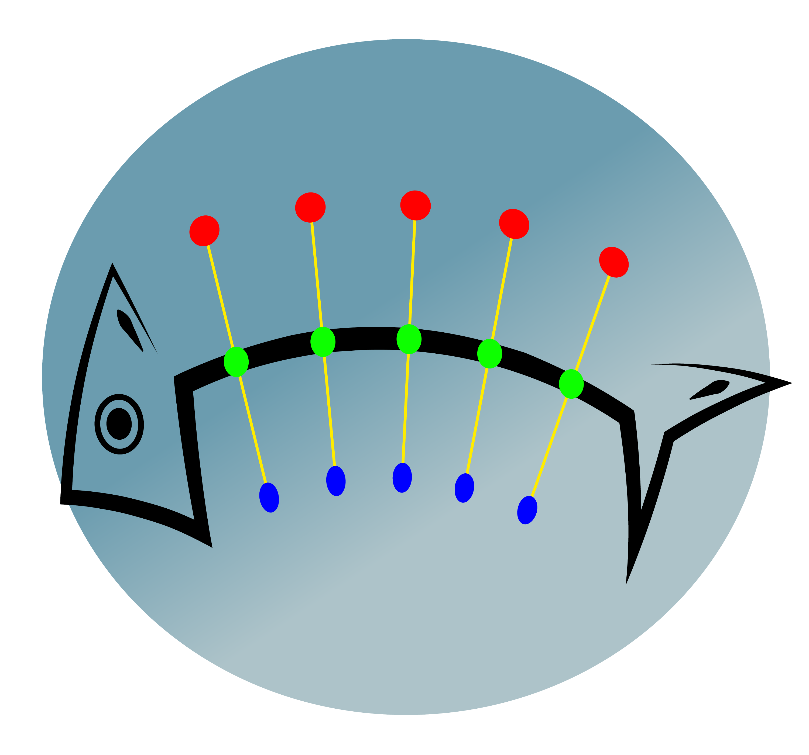
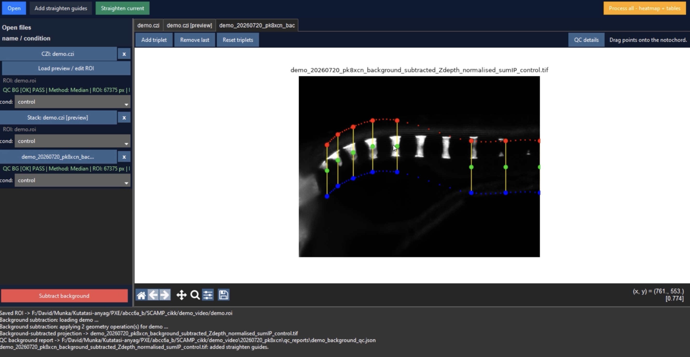

<p align="center">
  
</p>

<h1 align="center">SCAMP</h1>

SCAMP (Spinal Calcification & Mineralization Profiler) is a single-file Python GUI application for converting fluorescence z-stacks of Alizarin Red S-stained fish larvae into straightened spinal images and one-dimensional longitudinal intensity profiles.

## Tutorial video

<p align="center">
  <a href="https://github.com/danio-elte/SCAMP/blob/main/SCAMP-tutorial.mp4">
    
  </a>
</p>

## Main workflow

1. Create or select an experiment and define its experimental conditions.
2. Import CZI z-stacks with background ROIs, or open existing quantitative projection images.
3. Generate background-corrected projections.
4. Place landmark triplets along the notochord. The green point marks the approximate midline; the red and blue points define paired dorsal and ventral corridor boundaries.
5. Straighten the guide-defined spinal corridor.
6. Extract full-length column-sum intensity profiles and export cohort tables and heatmaps.

## Straightening algorithm

The quantitative straightening procedure uses the paired user-defined dorsal and ventral landmarks directly. Cubic-spline boundary curves shown in the GUI are visual guides and are not used as transform control points.

For each specimen, SCAMP:

- orders landmark triplets by their midline x-coordinate;
- calculates the midpoint of each dorsal–ventral pair;
- parameterizes the resulting centreline by cumulative Euclidean arc length;
- linearly interpolates paired dorsal and ventral coordinates along that arc length;
- creates a rectangular target grid whose width follows centreline arc length and whose height is based on the median corridor width;
- maps every target column to a dorsal-to-ventral source-image cross-section;
- samples source intensities using first-order interpolation.

No specimen-specific intensity normalization or thresholding is applied during straightening. The quantitative input scale is retained, but individual output pixels are interpolated values, and geometric resampling does not guarantee preservation of the global pixel-intensity sum.

## Profile extraction

SCAMP sums pixel intensities down each column of the straightened image to produce a one-dimensional rostro-caudal fluorescence profile. Profiles retain their full specimen-specific lengths; no intensity-based trimming is applied. For matrix export, shorter profiles are padded distally with `NaN` values so padding remains distinct from true zero intensity.

Length normalization to 1000 relative positions is not performed by this Python application. If used, it is a separate downstream R-analysis step and removes absolute profile-length information from the normalized representation.

## Requirements

Python 3.11 is recommended.

Core packages:

- `numpy`
- `scipy`
- `matplotlib`
- `Pillow`
- Tkinter, normally supplied with Python

Packages used by particular input/output features:

- `pandas` and `openpyxl` for XLSX export
- `scikit-image` for ImageJ ROI polygon handling and image rotation utilities
- `roifile` for ImageJ/Fiji ROI input
- `bioio` or `aicsimageio` for microscopy files
- `aicspylibczi` for additional CZI support
- `opencv-python` for additional image I/O
- `ttkbootstrap` for the optional modern GUI theme

The application checks optional dependencies at startup. Missing optional packages disable only their associated features where possible.

## Running SCAMP

Activate the Python environment containing the dependencies, then run:

```bash
python SCAMP.py
```

SCAMP requires a graphical desktop environment because its workflow uses Tkinter and embedded Matplotlib windows.

## Quantitative image handling

Background is estimated independently for each optical section from a user-defined ROI and subtracted from that section. Negative corrected values are clipped to zero. Projection and storage behavior depends on the selected projection mode. Generated quantitative TIFFs use a fixed storage scale when required to retain sub-integer values in 16-bit files; SCAMP converts these values back to native quantitative units before profile extraction.

Contrast-stretched previews are intended only for display and must not be used for quantitative analysis.

## Output organization

Outputs are grouped under the selected experiment identifier. Depending on the input and chosen processing steps, the experiment directory can include:

- background-corrected projection images;
- straightened quantitative TIFF images;
- per-step QC reports;
- combined CSV and XLSX profile matrices;
- cohort heatmaps in PDF or PNG format.

Generated filenames encode the source specimen, experiment identifier, processing stage, and assigned condition where applicable.

## Interpretation notes

- Straightening standardizes geometry but does not establish anatomical landmark correspondence between specimens.
- Raw Python profiles have specimen-specific arc-length-derived widths.
- Column sums depend on the sampled dorsal–ventral corridor, so landmark placement and corridor width must be applied consistently.
- A later fixed-length interpolation supports comparison at relative rostro-caudal positions but does not retain absolute spinal length.
- Quantitative analyses should use exported native-unit tables or quantitative TIFFs, never preview images.

## Please cite

_Citation details will be added once the preprint/article is available._
